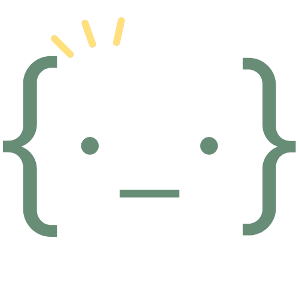
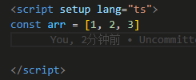
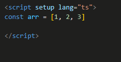
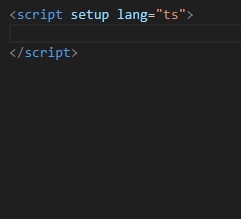

<p align="center">

</p>

<h1 align="center">Smart Dot <sup>VS Code</sup></h1>

<p align="center">
<a href="https://marketplace.visualstudio.com/items?itemName=Gahotx.smart-dot" target="__blank"></a>
<a href="https://open-vsx.org/extension/Gahotx/smart-dot" target="__blank"></a>
</p>

<p align="center">
Code completion with smart dot<br>
</p>

## Publishing

The extension can be published to both marketplaces:

```bash
pnpm run publish:vscode
pnpm run publish:openvsx
```

`publish:openvsx` requires an Open VSX personal access token in the `OVSX_PAT`
environment variable. The `Gahotx` namespace must also be created and claimed
on [Open VSX](https://open-vsx.org/). Publishing is possible while the
ownership claim is pending, but the extension remains unverified until the
claim is approved. For the tag-based GitHub Actions release, add the token as a repository secret
named `OVSX_PAT`. To publish to the VS Code Marketplace from Actions, also add
a Visual Studio Marketplace token as the `VSCE_PAT` repository secret.

To publish to both marketplaces after bumping the version, run:

```bash
pnpm run release
```

## Usage Examples

### console

<p align=center>

</p>

### array

<p align=center>

</p>

### vue

<p align=center>

</p>

## Configurations

| Key                  | Description                   | Type    |
| -------------------- | ----------------------------- | ------- |
| `smartDot.languages` | Smart Dot supported languages | `array` |
| `smartDot.options`   | Smart Dot format options      | `array` |

### smartDot.languages

```jsonc
// default languages
{
  "smartDot.languages": [
    "html",
    "javascript",
    "javascriptreact",
    "typescript",
    "typescriptreact",
    "vue"
  ]
}
```

### smartDot.options

```jsonc
// some default options
{
  "smartDot.options": [
    // console
    {
      "target": "log",
      "format": "console.log($label, $value)",
      "desc": "console.log('value', value)",
      "smartLabel": true
    },
    {
      "target": "info",
      "format": "console.info($label, $value)",
      "desc": "console.info('value', value)",
      "smartLabel": true
    },
    {
      "target": "warn",
      "format": "console.warn($label, $value)",
      "desc": "console.warn('value', value)",
      "smartLabel": true
    },
    {
      "target": "error",
      "format": "console.error($label, $value)",
      "desc": "console.error('value', value)",
      "smartLabel": true
    },
    // array
    {
      "target": "forof",
      "format": [
        "for (const value of $value) {",
        "  $cursor",
        "}"
      ],
      "desc": "for (const value of array) {}"
    },
    {
      "target": "forEach",
      "format": [
        "$value.forEach((item, index) => {",
        "  $cursor",
        "})"
      ],
      "desc": "array.forEach((item, index) => {})"
    },
    // vue
    {
      "target": "ref",
      "format": "const $value = ref($cursor)",
      "desc": "const $value = ref()"
    },
    {
      "target": "reactive",
      "format": "const $value = reactive($cursor)",
      "desc": "const $value = reactive()"
    },
    {
      "target": "computed",
      "format": [
        "const $value = computed(() => {",
        "  $cursor",
        "})"
      ],
      "desc": "const $value = computed(() => {})"
    }
  ]
}
```

#### IOption type

| key          | description                             | type               |
| ------------ | --------------------------------------- | ------------------ |
| `target`     | The target character to be replaced     | string             |
| `format`     | The format of the target character      | string \| string[] |
| `desc`       | The description of the option           | string             |
| `smartLabel` | Whether to display $Label intelligently | boolean            |

#### Keywords in format

| keyword   | description                      |
| --------- | -------------------------------- |
| `$simple` | The shortened form of $stamp     |
| `$stamp`  | The type of $value               |
| `$label`  | The label of $value              |
| `$value`  | The input value                  |
| `$cursor` | The cursor position after format |

## Thanks

- [dot-log](https://github.com/jaluik/dot-log)
- [dot-thing](https://github.com/vtrbo/dot-thing)
- [dot-more](https://github.com/AlanQtten/dot-more)
- [smart-clicks](https://github.com/antfu/vscode-smart-clicks)
- [starter-vscode](https://github.com/antfu/starter-vscode)

## License

[MIT](./LICENSE.md) License © 2024 [Gahotx](https://github.com/Gahotx)
